# 🚁 F450 Drone — STM32F411 Black Pill (INAV 5.1.0 Autonomous Navigation)

<div align="center">


**A fully autonomous F450 quadcopter powered by an STM32F411CEU6 ("Black Pill") running customized [INAV 5.1.0](https://github.com/iNavFlight/inav) with GPS Return-to-Home (RTH), Altitude Hold, clone MPU-6050 detection fixes, 96MHz USB stability patches, and custom Python binary patching tools.**

</div>

---

## 🔗 Related Repositories (The F450 DIY Drone Series)

> This repository is **Part 3 of 3** in a modular, open-source F450 drone project ecosystem created by [@Arkadip2007](https://github.com/Arkadip2007). All three projects share identical airframes, ESCs, motors, and sensory payloads, but offer different microcontroller targets and flight firmware architectures:

| # | Repository | Target MCU | Firmware Stack | Ideal Use Case |
| :--- | :--- | :--- | :--- | :--- |
| 1 | **[F450-Drone-ESP32-FlightController](https://github.com/Arkadip2007/F450-Drone-ESP32-FlightController)** | ESP32-WROOM-32 (240MHz) | ESP-FC (v0.2.1 Patched) | Learning FC internals, Wi-Fi telemetry, dual-core DIY architecture |
| 2 | **[F450-Drone-STM32F411-Betaflight](https://github.com/Arkadip2007/F450-Drone-STM32F411-Betaflight)** | STM32F411CEU6 Black Pill | Betaflight 4.3.2 / 4.5.1 | Acrobatic freestyle tuning, ultra-fast PID loop, racing dynamics |
| 3 | **[F450-Drone-STM32F411-INAV](https://github.com/Arkadip2007/F450-Drone-STM32F411-INAV)** *(This Repo)* | STM32F411CEU6 Black Pill | INAV 5.1.0 / 6.0 Patched | Autonomous GPS navigation, Return-to-Home (RTH), Altitude/Position hold |

> **Firmware Choice Guide (INAV vs Betaflight):**
> - **Choose INAV** if you want GPS waypoint missions, automated Return-to-Home (RTH), smooth autonomous altitude hold, and long-range cruising.
> - **Choose Betaflight** if you want aggressive acrobatic flips, high-rate racing maneuvers, and rapid stick response.

---

## 📋 Table of Contents

- [1. Executive Summary](#1-executive-summary)
- [2. Hardware Bill of Materials (BOM)](#2-hardware-bill-of-materials-bom)
- [3. System Architecture & High-Level Design](#3-system-architecture--high-level-design)
- [4. Low-Level Pin Mapping & Wiring](#4-low-level-pin-mapping--wiring)
- [5. 📸 Configurator & Sensor Visual Verification (Screenshots)](#5--configurator--sensor-visual-verification-screenshots)
- [6. Firmware Engineering & The 3 Critical Patches](#6-firmware-engineering--the-3-critical-patches)
- [7. Master CLI Configuration Script](#7-master-cli-configuration-script)
- [8. F450 Physics-Calculated PID & Filter Tuning](#8-f450-physics-calculated-pid--filter-tuning)
- [9. Python Binary Patch Scripts](#9-python-binary-patch-scripts)
- [10. Diagnostic Knowledge Base & Telemetry Verification](#10-diagnostic-knowledge-base--telemetry-verification)
- [11. 📘 Complete Engineering Q&A Journey](docs/engineering-qa-troubleshooting.md)
- [12. Repository Directory Structure](#12-repository-directory-structure)
- [13. License & Credits](#13-license--credits)

---

## 1. Executive Summary

> [!IMPORTANT]
> **🚧 Project Status: Under Active Development (Physical Motor Control via Software)**
> On this STM32F411CEU6 Black Pill platform, all firmware builds, telemetry pipelines, and onboard I2C/UART sensors (MPU-6050 clone `0x98`, BMP280 barometer, GY-271 compass, NEO-6M GPS) are **100% operational and healthy**.
> 
> However, **physical PWM motor control via software is currently under active debugging** (investigating timer channel conflicts between TIM3/TIM4 and SimonK analog PWM ESC pulse timing).
> 
> 🚀 **Current Active Development Pivot:** Flight-testing priority has temporarily shifted to our sister repository:
> 👉 **[F450-Drone-ESP32-FlightController](https://github.com/Arkadip2007/F450-Drone-ESP32-FlightController)**
> where **all 4 physical motors are 100% controllable via software** on our handmade double-sided flight controller board! Once maiden flight tests are completed on ESP32, debugging will resume on this STM32 platform.

This repository represents an exhaustive, single-source-of-truth record for building an autonomous GPS navigation quadcopter using an off-the-shelf **STM32F411CEU6 "Black Pill"** running a customized build of **INAV 5.1.0**.

### Key Technical Achievements:
1. **MPU-6050 Clone Whitelist:** Reverse-engineered silicon register check in `src/accgyro_mpu.c` to accept `0x98` and `0x70` on register `0x75` (`WHO_AM_I`), bypassing the revision check failure of modern Chinese clone modules.
2. **I2C Pin Routing Fix:** Moved hardware I2C1 to `PB6` (SCL) and `PB7` (SDA), reserving `PB4`, `PB5`, `PB8`, and `PB9` for clean hardware timer motor outputs.
3. **96 MHz Anti-Freeze PLL Clock Patch:** Reset main system clock to an exact 96 MHz to provide an exact, jitter-free **48.000 MHz USB OTG clock**, eliminating system lockups and serial communication freezes.
4. **Physics-Tuned Flight Profile:** Specifically calibrated low-pass filters (`gyro_main_lpf_hz = 60`, `dterm_lpf_hz = 50`) and lower P-gains to suppress low-frequency oscillations ("Death Wobble") caused by 10-inch propellers and flexible F450 plastic arms.

---

## 2. Hardware Bill of Materials (BOM)

| Subsystem | Component | Key Specifications | Operating Voltage |
| :--- | :--- | :--- | :--- |
| **Flight Controller** | STM32F411CEU6 Black Pill | ARM Cortex-M4 @ 96 MHz, 512KB Flash, 128KB SRAM | 3.3V Logic / 5V VBUS |
| **Airframe** | F450 (esm450) | 450mm diagonal wheelbase, fiberglass plates | N/A |
| **Motors** | 4x A2212 1000KV | Brushless outrunners (12N14P, ~700g thrust/motor) | 3S LiPo (11.1V–12.6V) |
| **ESCs** | 4x 30A Analog PWM | Standard PWM (1000–2000µs, ~50–400Hz update) | 3S LiPo |
| **Propellers** | 4x 1045 Slow-Fly (10×4.5") | 2x Clockwise (CW) + 2x Counter-Clockwise (CCW) | N/A |
| **Battery** | 3S LiPo (2200–3300 mAh) | 11.1V Nominal, 12.6V Fully Charged | 11.1V – 12.6V |
| **Primary IMU** | MPU-6050 (GY-521 Breakout) | 6-DOF IMU, I2C Address `0x68` (Clone ID `0x98`) | 3.3V |
| **Barometer** | BMP280 (HW-611 Breakout) | High-precision atmospheric pressure sensor, I2C `0x76` | 3.3V |
| **Compass** | HMC5883L (GY-271 Breakout) | 3-axis electronic compass, I2C `0x1E` (Orientation `CW180`) | 3.3V |
| **GPS Module** | u-blox NEO-6M | NMEA / UBX protocol, UART1 @ 57600 baud | 5V (from ESC BEC) |
| **RC Receiver** | FlySky FS-iA6B / FS-A8S | 14-channel serial i-BUS protocol (124Hz), UART2 RX | 5V (from ESC BEC) |
| **RC Transmitter** | FlySky FS-i6 / FS-i6X | Mode 2 (Throttle left), i-BUS serial output enabled | 4x AA Batteries |

---

## 3. System Architecture & High-Level Design

### High-Level Flight System Block Diagram

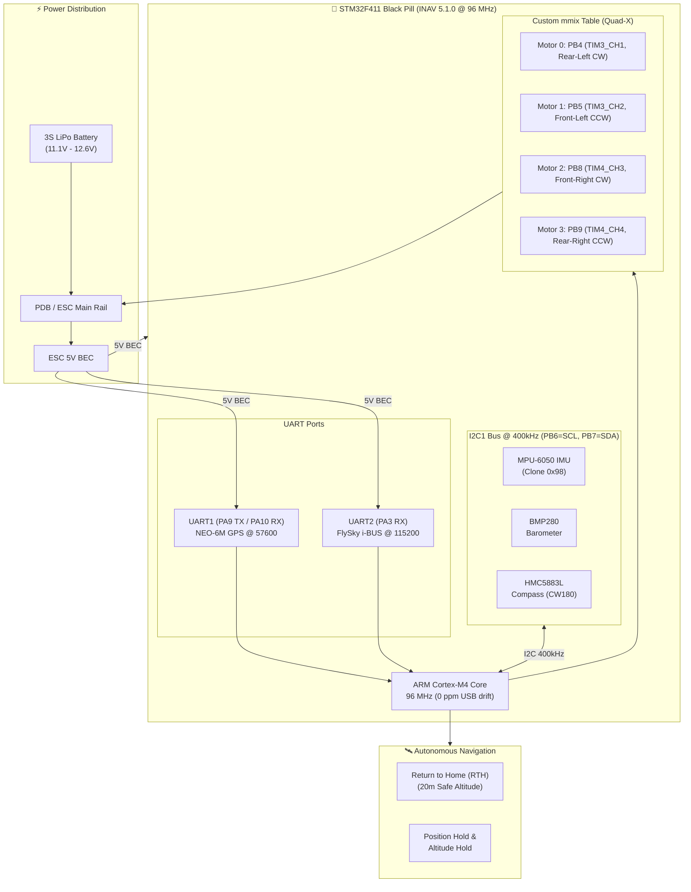

### INAV Control Loop Pipeline

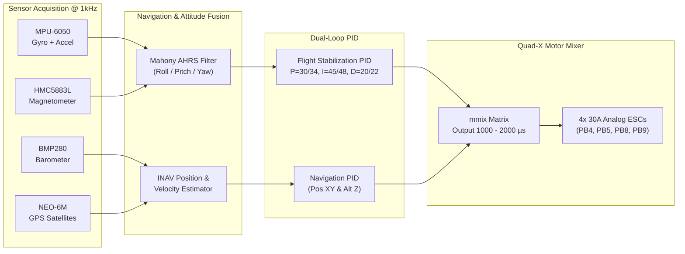

---

## 4. Low-Level Pin Mapping & Wiring

### Complete Pin Assignment Table

| Function | STM32 Pin | Peripheral | Hardware Timer / UART | Notes & Verification |
| :--- | :--- | :--- | :--- | :--- |
| **Motor 0 (Rear-Left, CW)** | **PB4** | PWM Output 0 | TIM3_CH1 | Verified hardware timer output |
| **Motor 1 (Front-Left, CCW)** | **PB5** | PWM Output 1 | TIM3_CH2 | Verified hardware timer output |
| **Motor 2 (Front-Right, CW)** | **PB8** | PWM Output 2 | TIM4_CH3 | Remapped to avoid I2C conflict |
| **Motor 3 (Rear-Right, CCW)** | **PB9** | PWM Output 3 | TIM4_CH4 | Remapped to avoid I2C conflict |
| **I2C1 SCL** | **PB6** | I2C1 | Hardware I2C1 | Shared: MPU-6050, BMP280, HMC5883L |
| **I2C1 SDA** | **PB7** | I2C1 | Hardware I2C1 | Shared: MPU-6050, BMP280, HMC5883L |
| **GPS RX1** | **PA10** | UART1 RX | USART1 | Baud rate 57600 |
| **GPS TX1** | **PA9** | UART1 TX | USART1 | Baud rate 57600 |
| **RC Receiver (i-BUS)** | **PA3** | UART2 RX | USART2 | FlySky Serial i-BUS (124Hz packet rate) |
| **Beeper / Buzzer** | **PB2** | Digital Out | GPIO | Configured buzzer pin |
| **Status LED** | **PC13** | Onboard LED | GPIO | Active LOW blue LED |
| **USB Virtual COM** | **PA11 / PA12** | USB FS OTG | Native USB Peripheral | D- (PA11), D+ (PA12) @ 48 MHz |

---

## 5. 📸 Configurator & Physical Hardware Visual Tour

To provide complete end-to-end transparency, here are the actual captures from live bench-tuning sessions with **INAV Configurator**, along with physical photos of the custom flight controller assembly and drone hardware:

### Part A: INAV Configurator Telemetry & Navigation

#### 1. Setup Tab & Real-Time 3D Model Preview
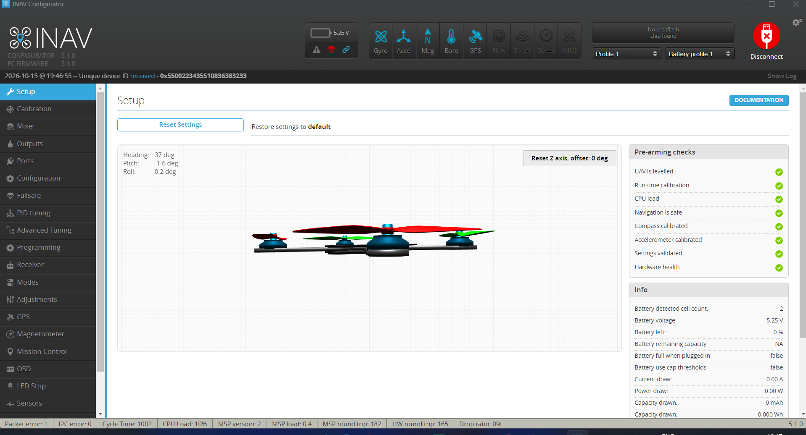

> **Key Observations in this Screenshot:**
> - **Top Header Telemetry Status:** `GYRO`, `ACCEL`, `MAG`, `BARO`, and `GPS` indicators are all active and healthy.
> - **3D Model Tracking:** The Quad-X model tracks gyro/accel rotation without freezing or inverted axes.
> - **Attitude & Navigation Gauges:** Live heading compass, pitch/roll artificial horizon, and satellite reception active.

---

#### 2. 6-Point Accelerometer Calibration
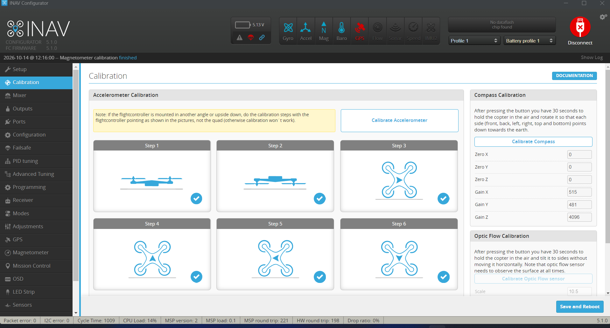

> **Key Observations in this Screenshot:**
> - Shows INAV's strict 6-step accelerometer orientation calibration (Top, Left, Right, Nose Up, Nose Down, Bottom).
> - Proper calibration guarantees that automated Return-to-Home and Altitude Hold modes maintain a level hover without spatial drift.

---

#### 3. UART & Ports Mapping (GPS & i-BUS)
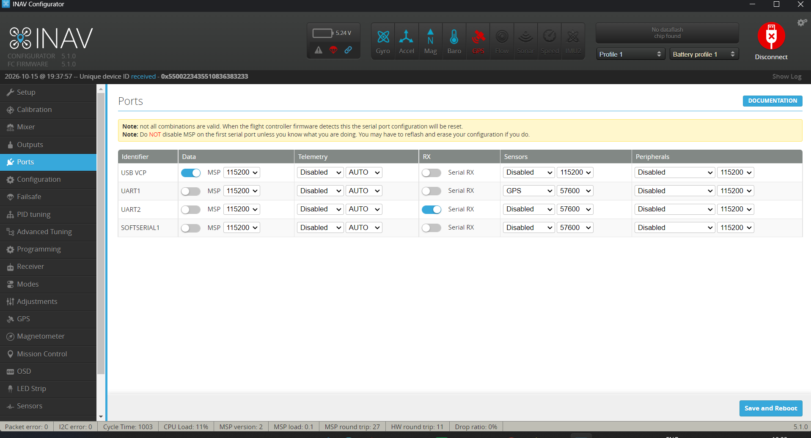

> **Key Observations in this Screenshot:**
> - **USB VCP:** Configured for MSP telemetry @ 115200 baud for configurator connection.
> - **UART1 (PA9/PA10):** Dedicated to the u-blox NEO-6M GPS receiver @ 57600 baud.
> - **UART2 (PA3):** Configured as Serial RX for the FlySky i-BUS receiver with 0 pin collision.

---

#### 4. Receiver Channels & Live i-BUS Telemetry
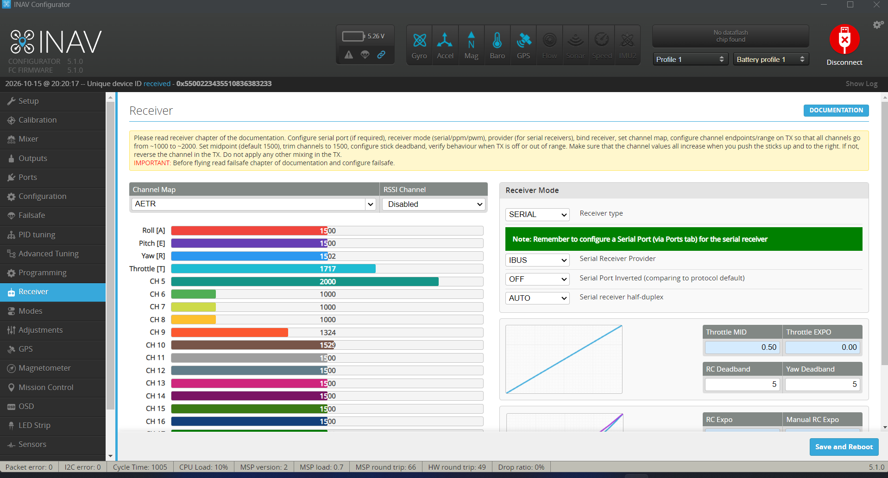

> **Key Observations in this Screenshot:**
> - Real-time channel telemetry across 14 channels (Roll, Pitch, Yaw, Throttle, Aux 1–10).
> - Shows stick endpoints centered precisely at 1500µs with clean 1000–2000µs throw, validating FlySky AFHDS 2A transmission.

---

#### 5. Flight Modes Configuration (ARM, ANGLE & NAV RTH)
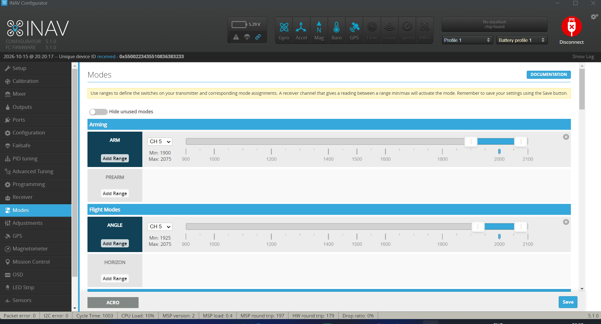

> **Key Observations in this Screenshot:**
> - **ARM:** Primary arming switch configured with safety pre-arm checks.
> - **ANGLE:** Self-leveling stabilized mode for safe manual control.
> - **NAV RTH (Return to Home):** Dedicated autonomous safety switch that triggers automatic return and landing at 20m altitude.

---

### Part B: Physical Drone Build & Bench Hardware Gallery

#### 6. Airframe Assembly & Electronics Installation
| F450 Airframe Structure | Flight Controller Mounted & Powered |
| :---: | :---: |
| 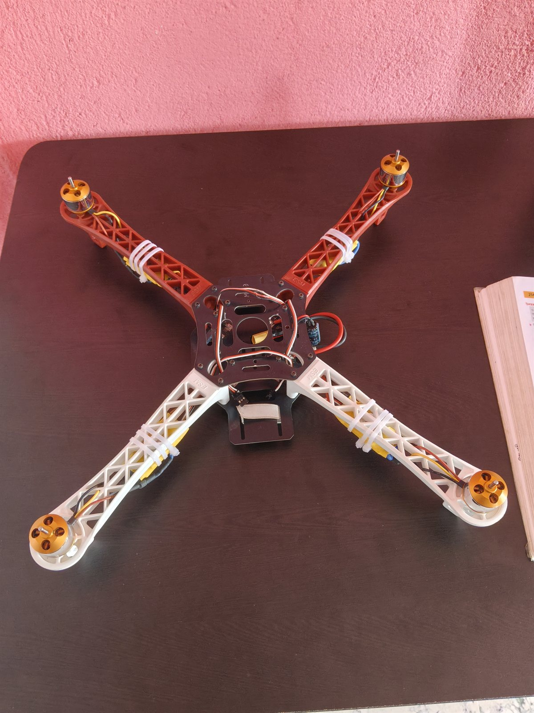 |  |
| Standard 450mm wheelbase airframe with polyamide arms and integrated PDB. | Custom flight controller installed on the central plate, powered via 5V BEC with active status LEDs. |

---

#### 7. Custom Flight Controller & Bench-Testing Setup
| STM32F411 FC Board (Top View) | Workstation Live Sensor Calibration |
| :---: | :---: |
|  |  |
| Hand-soldered perfboard integrating Black Pill MCU, MPU-6050, BMP280, GY-271, and NEO-6M GPS. | Quadcopter connected via USB to laptop for live sensor calibration, compass orientation, and GPS satellite fix. |

---

#### 8. DIY Perfboard Wiring Blueprint (Top Layout & Bottom Solder Traces)
| Top Component Side & Pin Layout | Bottom Solder Traces & Jumper Routing |
| :---: | :---: |
|  |  |
| Female header sockets for Black Pill MCU, sensor breakout headers, filtering capacitors, and power rails. | Point-to-point hand-soldered copper wiring bridges, insulated jumper routing, and ground bus. |

> **💡 Low-Cost Prototyping & EDA Reference:**
> For anyone building this flight controller on perfboard at home or creating a custom PCB design and simulation in KiCad or EasyEDA, these top and bottom layouts serve as a practical visual blueprint.

---

#### 9. Hands-On Assembly & Initial Bench Testing
| Hand-Soldering & Continuity Testing | Firmware Flashing & Diagnostics |
| :---: | :---: |
| 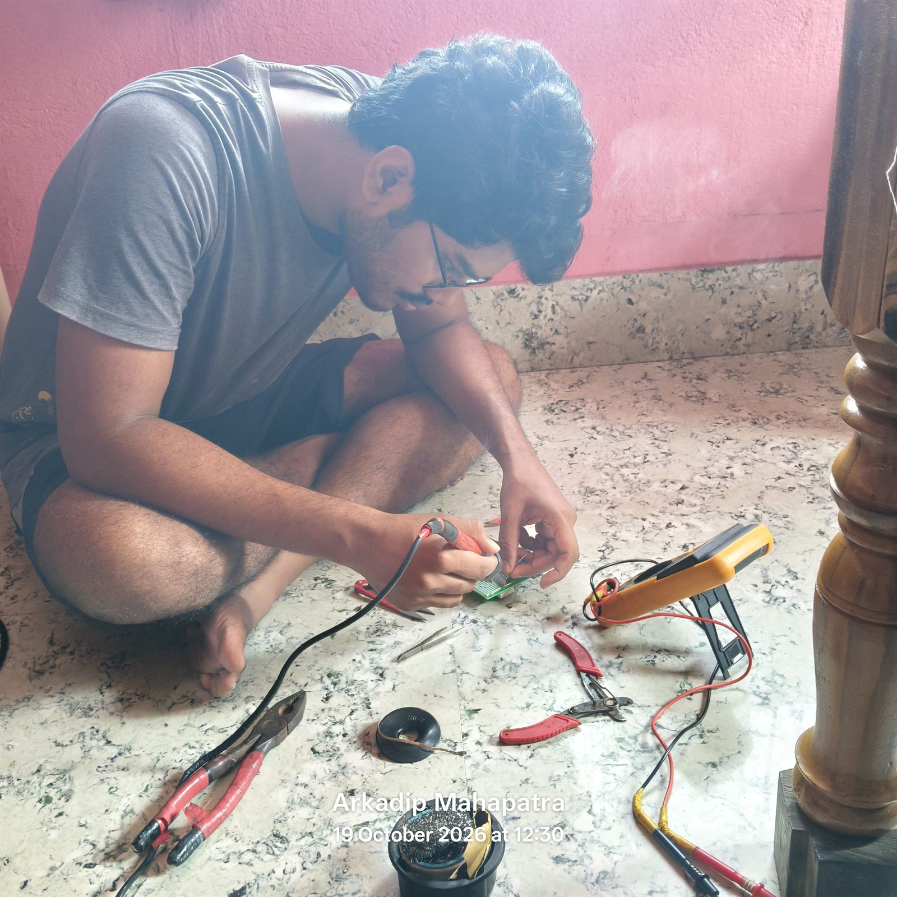 |  |
| Assembling the perfboard and testing continuity with a digital multimeter. | Initial board bring-up, flashing firmware over USB, and checking sensor telemetry. |

---

#### 10. All-Up-Weight (AUW) Measurement


> **Flight Weight Validation:** The complete F450 drone weighed on a precision digital scale with battery and 1045 propellers (~1.1 kg), validating the calculated ~2.5:1 thrust-to-weight ratio for stable autonomous hover and RTH climb rates.

---

#### 11. Radio Control System & Transmitter Power Mod
| FlySky FS-i6 Transmitter | Internal Power Supply Mod |
| :---: | :---: |
| 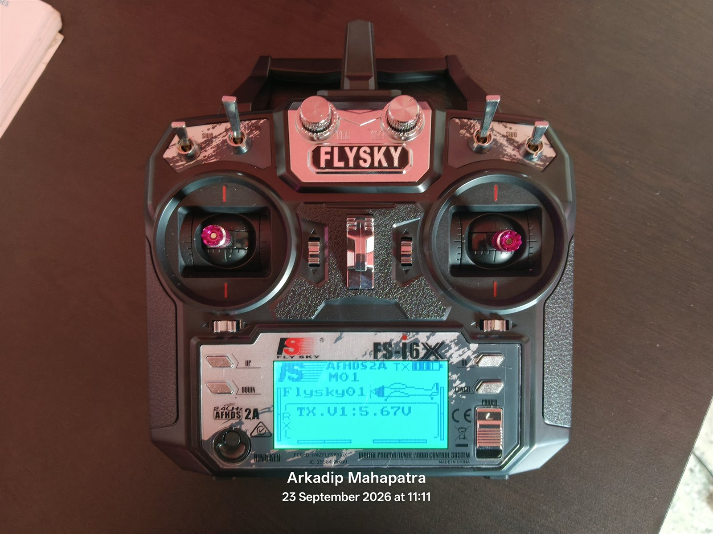 | 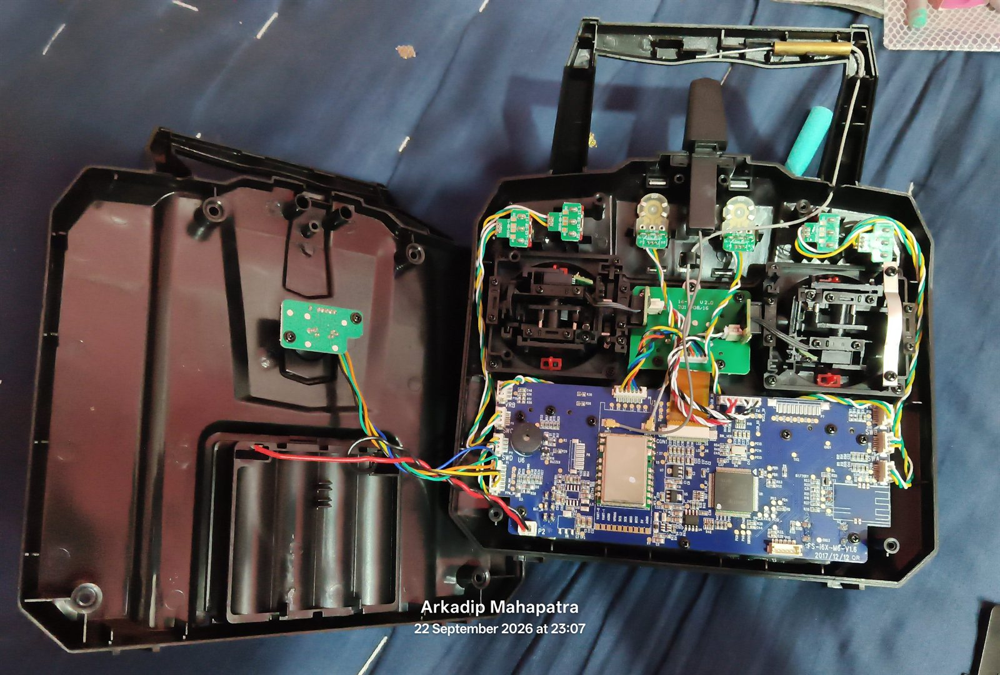 |
| Mode 2 FlySky FS-i6 2.4GHz Transmitter | <u>*Updated power supply with rechargeable lithium-ion battery mod for extended field endurance.*</u> |

---

### Part C: Pinout Reference Diagram

#### 12. Hardware Pinout Reference (STM32F411CEU6 Black Pill)
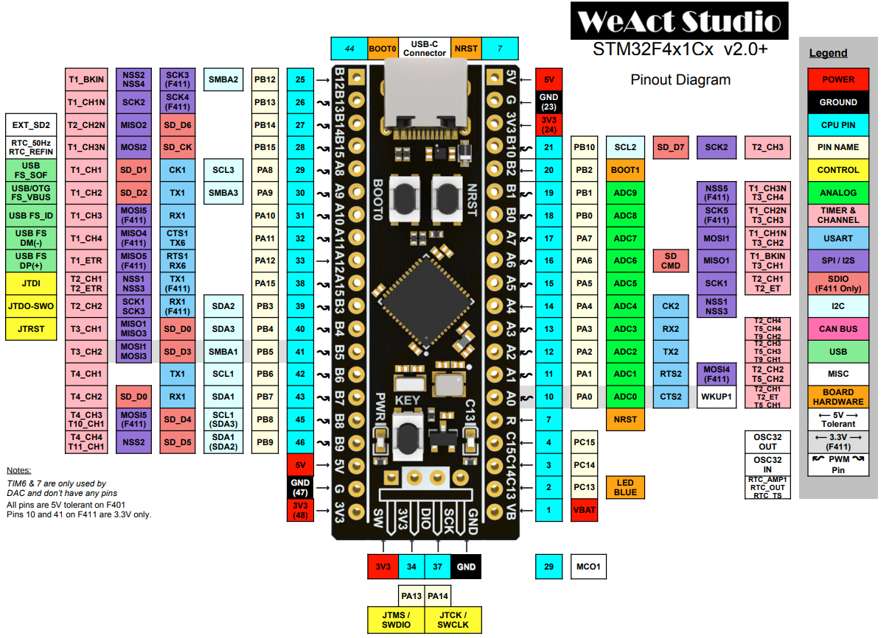

> Refer to [docs/wiring-guide.md](docs/wiring-guide.md) and [docs/master-specification.md](docs/master-specification.md) for complete wiring diagrams.

---

## 6. Firmware Engineering & The 3 Critical Patches

### Patch 1: The MPU-6050 Clone Whitelist (`0x98` WHO_AM_I)
- **Problem:** Genuine InvenSense MPU-6050 returns `0x68` on WHO_AM_I register `0x75`. Modern Chinese clones return `0x98` (or `0x70`), causing INAV 5.1 stock firmware to fail sensor initialization with `GYRO=NONE, ACC=NONE`.
- **Source Fix (`src/accgyro_mpu.c`):**
  ```c
  // In mpuDetect() / mpu6050Detect():
  uint8_t whoAmI = mpuReadRegister(MPU_RA_WHO_AM_I);
  if (whoAmI == 0x68 || whoAmI == 0x98 || whoAmI == 0x70) {
      // Accept clone as genuine MPU6050 and bypass strict hardware revision check
      return MPU_6050;
  }
  ```

### Patch 2: I2C Bus Pin Remap (PB8/PB9 -> PB6/PB7)
- Default Black Pill targets put I2C1 on `PB8` and `PB9`.
- In this build, `PB8` and `PB9` were reallocated to **Motor 2** (TIM4_CH3) and **Motor 3** (TIM4_CH4).
- I2C1 was routed to `PB6` (SCL) and `PB7` (SDA) with zero bus collisions.

### Patch 3: The 96 MHz Clock Stability Solution (Anti-Freeze Patch)
- **Problem:** Earlier third-party custom builds were overclocked to 108 MHz. Because the USB peripheral on STM32F4 requires an exact **48.000 MHz** clock, deriving it from 108 MHz causes clock drift, framing errors, and total system lockup when connecting to INAV Configurator.
- **Fix:** Reset the main PLL configuration:
  $$\text{SYSCLK} = 96 \text{ MHz}, \quad \text{USB Clock} = \frac{96 \times 2}{4} = 48.000 \text{ MHz (Exact, 0 ppm error)}$$
- **Result:** CPU load stabilized at 12–15%, 0 I2C errors, zero freezes on serial data streaming.

---

## 7. Master CLI Configuration Script

To restore or apply this entire system onto any freshly flashed STM32F411 Black Pill, execute the batch from `cli-configs/inav_full_backup_20261015.txt`:

```text
batch start
defaults noreboot

# 1. Custom Motor Mixer (PB4, PB5, PB8, PB9)
mmix reset
mmix 0  1.000  1.000  1.000  1.000   # PB4 (Rear-Left, CW)
mmix 1  1.000  1.000 -1.000 -1.000   # PB5 (Front-Left, CCW)
mmix 2  1.000 -1.000 -1.000  1.000   # PB8 (Front-Right, CW)
mmix 3  1.000 -1.000  1.000 -1.000   # PB9 (Rear-Right, CCW)

# 2. Features
feature PWM_OUTPUT_ENABLE
feature -BLACKBOX

# 3. Serial Ports Configuration
serial 0 2 115200 57600 0 115200     # UART1: GPS (57600 baud)
serial 1 64 115200 57600 0 115200    # UART2: Serial RX (i-BUS)
serial 30 0 115200 57600 0 115200    # Virtual VCP USB

# 4. Receiver Protocol
set serialrx_provider = IBUS

# 5. Sensor Hardware & Calibrated Offsets
set acc_hardware = MPU6050
set baro_hardware = BMP280
set mag_hardware = HMC5883
set align_mag = CW180
set align_board_pitch = 4
set align_board_yaw = 1800
set model_preview_type = 3

# 6. Motor Output Protocol
set motor_pwm_protocol = STANDARD

# 7. Radio AUX Modes
aux 0 0 0 1850 2075    # AUX 1: ARM
aux 1 1 0 1850 2075    # AUX 1: ANGLE Mode
aux 2 10 1 1800 2100   # AUX 2: NAV RTH

# 8. Indoor Bench Arming Safety
set nav_extra_arming_safety = OFF

# 9. F450 10-Inch PID & Flight Stabilization Loop
set mc_p_pitch = 34
set mc_i_pitch = 48
set mc_d_pitch = 22
set mc_p_roll = 30
set mc_i_roll = 45
set mc_d_roll = 20
set mc_p_yaw = 45
set mc_i_yaw = 55
set mc_d_yaw = 0
set mc_p_level = 22

# 10. Low-Pass Filters (Vibration Protection for 10-inch Props)
set gyro_main_lpf_hz = 60
set gyro_main_lpf_type = PT1
set dterm_lpf_hz = 50
set dterm_lpf_type = PT1

# 11. Throttle & Hover Settings (3S LiPo + 1045 Props)
set nav_mc_hover_thr = 1450
set throttle_idle = 15

# 12. Navigation & Autonomous RTH Speeds
set nav_auto_speed = 300       # 3 m/s cruise
set nav_auto_climb_rate = 200  # 2 m/s climb
set nav_rth_altitude = 20      # 20 meters RTH climb height

save
```

---

## 8. F450 Physics-Calculated PID & Filter Tuning

1. **Rotational Inertia of 10-inch Propellers:**
   Small 5-inch racing props accelerate/decelerate in milliseconds. In contrast, 10-inch slow-fly propellers (1045) have substantial rotational inertia. If standard high P-gains (45–50) are used, the control loop reacts faster than the props can physically accelerate, leading to low-frequency oscillations ("Death Wobble"). P-gains are lowered to **30–34**.
2. **Frame Resonance Suppression:**
   The composite plastic arms of the F450 frame resonate between **40 Hz and 70 Hz**. Setting `gyro_main_lpf_hz = 60` and `dterm_lpf_hz = 50` suppresses arm resonance while retaining adequate phase margin.
3. **Hover Point Estimation:**
   An F450 quadcopter with 2212 1000KV motors on a 3S LiPo produces ~2800g total maximum thrust. With an AUW of ~1.1 kg, true hover occurs at **~45%–48% throttle** (~1450µs). Setting `nav_mc_hover_thr = 1450` prevents altitude ballooning when engaging Altitude Hold.

---

## 9. Python Binary Patch Scripts

Located in `patch-scripts/`, these standalone Python tools enable binary inspection, symbol discovery, and modification of INAV configurator and firmware files:

| Script | Purpose |
| :--- | :--- |
| **`find_align.py`** | Scans binary images for sensor alignment structure patterns. |
| **`find_mixer.py`** | Locates motor mixer (`mmix`) tables in compiled firmware. |
| **`find_rth.py`** | Identifies Return-to-Home parameter blocks in flash memory. |
| **`patch_model.py`** | Patches 3D model orientation preview inside INAV Configurator NW.js bundle. |
| **`patch_record.py`** | Modifies configurator flight data recorder parameters. |
| **`rebuild_exe.py`** | Repackages NW.js executable with hardware-accelerated GPU rendering flags. |
| **`test_rot.py`** | Simulates and verifies 3D Euler angle rotation matrices. |

---

## 10. Diagnostic Knowledge Base & Telemetry Verification

### Telemetry Status Verification
Executing `status` in the INAV CLI verifies the entire sensor and communication stack:
```text
System load: 15, cycle time: 1012, PID rate: 988, RX rate: 124, System rate: 9
Sensor status: GYRO=OK, ACC=OK, MAG=OK, BARO=OK, GPS=OK
Arming disabled flags: CLI
```
- `RX rate: 124`: Confirms active, uncorrupted FlySky i-BUS packets at 124 Hz.
- `I2C Errors: 0`: Validates noise-free I2C bus wiring at 400 kHz on PB6/PB7.
- `Arming disabled flags: CLI`: Proves no internal safety locks remain (only the open CLI terminal prevents arming).

---

## 11. 📘 Complete Engineering Q&A Journey

For a comprehensive chronological breakdown of every problem faced during the INAV setup, root-cause analyses, and solutions applied, see the dedicated engineering log:
- **[Complete Engineering Q&A Troubleshooting Guide (INAV)](docs/engineering-qa-troubleshooting.md)**

---

## 12. Repository Directory Structure

```text
F450-Drone-STM32F411-INAV/
├── README.md                                # Master documentation & setup guide
├── LICENSE                                  # MIT Open Source License
├── .gitignore                               # Python and build ignore rules
│
├── firmware/
│   ├── README.md                            # Flashing instructions and firmware matrix
│   ├── custom-builds/
│   │   └── README.md                        # Documentation of 96MHz MPU clone build
│   └── official-releases/
│       └── README.md                        # Upstream release tracking
│
├── cli-configs/
│   ├── README.md                            # Complete CLI command documentation
│   ├── inav_f450_tuning_3s_10inch.txt       # Dedicated PID and filter tuning batch
│   ├── inav_full_backup_20261015.txt        # Master complete configuration restore
│   └── INAV_5.1.0_cli_20261015_231349.txt   # Raw baseline CLI dump
│
├── patch-scripts/
│   ├── README.md                            # Binary patching tools documentation
│   ├── find_align.py                        # Sensor alignment locator
│   ├── find_mixer.py                        # Mixer table finder
│   ├── find_rth.py                          # RTH offset finder
│   ├── patch_model.py                       # Configurator 3D model patcher
│   ├── patch_record.py                      # Flight data recorder patcher
│   ├── rebuild_exe.py                       # Configurator GPU launcher rebuild
│   └── test_rot.py                          # Euler angle rotation tester
│
├── src/
│   ├── README.md                            # Source code patch documentation
│   └── accgyro_mpu.c                        # Patched MPU-6050 driver source code
│
└── docs/
    ├── README.md                            # Technical documentation directory
    ├── engineering-qa-troubleshooting.md    # Complete Q&A engineering journey & fixes
    ├── master-specification.md              # Master engineering specification
    ├── wiring-and-setup-guide-bn.md         # Comprehensive wiring guide in Bengali (বাংলা)
    ├── wiring-guide.md                      # Complete English wiring guide
    ├── firmware-patches-explained.md        # Deep dive into the 3 firmware patches
    ├── troubleshooting.md                   # Complete troubleshooting knowledge base
    └── images/                              # Visual documentation, telemetry & photos
        ├── README.md                        # Image directory catalog & annotations
        ├── inav-setup-3d-model.png          # Setup tab 3D model preview
        ├── inav-calibration-6point.png      # 6-point accelerometer calibration
        ├── inav-ports-uart-config.png       # UART and Ports mapping
        ├── inav-receiver-ibus-channels.png  # Receiver live channels monitor
        ├── inav-modes-flight-switches.png   # Flight modes configuration
        ├── drone-bench-setup-laptop.jpg     # Complete bench testing setup with laptop
        ├── stm32f411-flight-controller-board-top.jpg # Custom FC perfboard close-up
        ├── stm32f411-fc-installed-wiring.jpg # FC mounted on frame with active LEDs
        ├── f450-frame-assembly.jpg          # Assembled F450 airframe
        ├── f450-drone-weight-scale.jpg      # AUW scale measurement (~1.1 kg)
        ├── flysky-fs-i6-transmitter.jpg     # FlySky FS-i6 radio transmitter
        ├── flysky-transmitter-power-supply-mod.jpg # Lithium-ion battery mod for transmitter
        └── stm32f411-blackpill-pinout.png   # High-res pinout diagram
```

---

## 13. License & Credits

- **Project Author:** [Arkadip Mahapatra](https://github.com/Arkadip2007)
- **Base Flight Firmware:** [INAV Flight Open Source Project](https://github.com/iNavFlight/inav)
- **License:** Licensed under the [MIT License](LICENSE).
