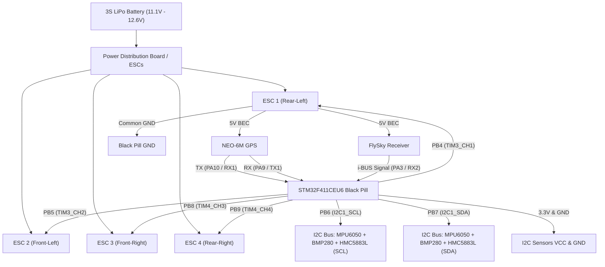

# F450 Quadcopter Autonomous Flight Controller Specification & Project Record
**Target Hardware:** STM32F411CEU6 ("Black Pill")  
**Firmware Architecture:** Custom INAV 5.1.0 (96 MHz Stable Core, MPU6050 Clone Patched)  
**Frame & Propulsion:** F450 Quad X, 2212 1000KV Motors, 30A Analog PWM ESCs, 1045 Propellers, 3S LiPo  
**Radio System:** FlySky FS-i6 / FS-i6X Transmitter with i-BUS Serial Receiver  
**Navigation Sensors:** MPU-6050 (6-DOF IMU), BMP280 (Barometer), HMC5883L (Magnetometer), NEO-6M (GPS)  

---

## 1. Executive Summary & Purpose
This document provides a single-source-of-truth record for the custom-built autonomous quadcopter developed on an **STM32F411CEU6 Black Pill** running a customized build of **INAV 5.1.0**. 

It encapsulates:
1. Complete hardware Bill of Materials (BOM) and mechanical configuration.
2. Custom pinouts and hardware timer mappings.
3. Firmware-level bug fixes (MPU-6050 clone `0x98` detection, I2C pin remapping to PB6/PB7, 96 MHz PLL jitter fix).
4. Configurator GPU rendering patches and GUI bug workarounds.
5. Exact, verified INAV CLI configuration scripts (Sensors, Motors, Receiver, Modes, Navigation).
6. Physics-calculated custom PID and filter tuning for 10-inch propellers on an F450 frame with a 3S battery.
7. Diagnostics, arming lockouts, and bench-testing procedures.

Any AI assistant, software engineer, or avionics hobbyist reading this document will have complete context to reproduce, maintain, debug, or extend this flight platform without needing prior conversation transcripts.

---

## 2. Hardware Bill of Materials & Technical Specifications

| Subsystem | Component | Key Specifications | Operating Voltage |
| :--- | :--- | :--- | :--- |
| **Airframe** | F450 (esm450) | 450mm diagonal wheelbase, fiberglass center plates, plastic arms | N/A |
| **Flight Controller** | STM32F411CEU6 ("Black Pill") | ARM Cortex-M4 @ 96 MHz, 512KB Flash, 128KB SRAM, 25MHz external crystal | 3.3V logic / 5V VBUS |
| **Motors** | 4x A2212 1000KV | Brushless outrunner, 12N14P, ~12A max draw, 1000 RPM/V | 3S (11.1V - 12.6V) |
| **ESCs** | 4x 30A Standard PWM | Analog PWM protocol (1000µs–2000µs, ~50–400Hz update), 5V 2A BEC | 3S LiPo |
| **Propellers** | 4x 1045 Slow-Fly (10x4.5) | 10-inch diameter, 4.5-inch pitch, flexible plastic, 2x CW + 2x CCW | N/A |
| **Battery** | 3S LiPo Battery | 3-cell Lithium Polymer, 11.1V nominal, 12.6V fully charged | 11.1V - 12.6V |
| **Primary IMU** | MPU-6050 (GY-521) | 3-axis accelerometer + 3-axis gyroscope, clone returning `0x98` on WHO_AM_I | 3.3V |
| **Barometer** | BMP280 (HW-611) | High precision barometric pressure & altitude sensor, I2C address `0x76` | 3.3V |
| **Magnetometer** | HMC5883L (GY-271) | 3-axis electronic compass, I2C address `0x1E`, orientation `CW180` | 3.3V |
| **GPS Module** | NEO-6M / UBLOX | NMEA/UBX serial GPS with external patch antenna | 5V (from ESC BEC) |
| **RC Receiver** | FlySky i-BUS Receiver | AFHDS 2A, 14-channel serial i-BUS protocol, 124Hz packet rate | 5V (from ESC BEC) |
| **RC Transmitter** | FlySky FS-i6 / FS-i6X | 6-10 channels, Mode 2 (Throttle left), i-BUS serial output enabled | 4x AA (6V) |

---

## 3. Physical Wiring Diagram & Hardware Pinout



### Complete Pin Assignment Table

| Function | Pin Name | Peripheral | Hardware Timer / UART | Notes |
| :--- | :--- | :--- | :--- | :--- |
| **Motor 0 (Rear-Left)** | **PB4** | PWM Output 0 | TIM3_CH1 | User verified final wiring |
| **Motor 1 (Front-Left)** | **PB5** | PWM Output 1 | TIM3_CH2 | User verified final wiring |
| **Motor 2 (Front-Right)** | **PB8** | PWM Output 2 | TIM4_CH3 | User verified final wiring |
| **Motor 3 (Rear-Right)** | **PB9** | PWM Output 3 | TIM4_CH4 | User verified final wiring |
| **I2C1 SCL** | **PB6** | I2C1 | Hardware I2C1 | Shared: MPU6050, BMP280, HMC5883L |
| **I2C1 SDA** | **PB7** | I2C1 | Hardware I2C1 | Shared: MPU6050, BMP280, HMC5883L |
| **GPS RX1** | **PA10** | UART1 RX | USART1 | Baud rate 57600 |
| **GPS TX1** | **PA9** | UART1 TX | USART1 | Baud rate 57600 |
| **RC Receiver (i-BUS)** | **PA3** | UART2 RX | USART2 | FlySky Serial i-BUS |
| **Status LED** | **PC13** | Onboard LED | GPIO | Active LOW |
| **Beeper / Buzzer** | **PB2** | Digital Out | GPIO | Configured buzzer pin |
| **USB Virtual COM** | **PA11 / PA12** | USB FS OTG | Native USB Peripheral | D- (PA11), D+ (PA12) @ 48 MHz |

---

## 4. Motor Order, Spin Directions & Mixer Math (`mmix`)

In standard INAV Quad X flight mechanics with **Props In**:
* **Motor 0 (PB4 - Rear-Left):** Rotates **CW** (Clockwise). Requires +Roll, +Pitch, +Yaw.
* **Motor 1 (PB5 - Front-Left):** Rotates **CCW** (Counter-Clockwise). Requires +Roll, -Pitch, -Yaw.
* **Motor 2 (PB8 - Front-Right):** Rotates **CW** (Clockwise). Requires -Roll, -Pitch, +Yaw.
* **Motor 3 (PB9 - Rear-Right):** Rotates **CCW** (Counter-Clockwise). Requires -Roll, +Pitch, -Yaw.

### Applied Custom Motor Mixer (`mmix`) Table

```text
# mmix <index> <throttle> <roll> <pitch> <yaw>
mmix 0  1.000  1.000  1.000  1.000   # PB4 (Rear-Left, CW)
mmix 1  1.000  1.000 -1.000 -1.000   # PB5 (Front-Left, CCW)
mmix 2  1.000 -1.000 -1.000  1.000   # PB8 (Front-Right, CW)
mmix 3  1.000 -1.000  1.000 -1.000   # PB9 (Rear-Right, CCW)
```

> [!IMPORTANT]
> The motor indexing starts at `0` in CLI (`mmix 0` = Output 0 / PB4). Propellers must be mounted with text facing upward and matching the rotation directions above (Motor 0 CW, Motor 1 CCW, Motor 2 CW, Motor 3 CCW).

---

## 5. Firmware Engineering & Custom Hex Patches

### A. The MPU-6050 Clone Patch (`0x98` WHO_AM_I)
* **Problem:** Authentic InvenSense MPU-6050 returns `0x68` on WHO_AM_I register `0x75`. Modern Chinese clones return `0x98` (or `0x70`), causing INAV 5.1 stock firmware to fail sensor initialization with `GYRO=NONE, ACC=NONE`.
* **Fix in `accgyro_mpu.c`:**
  ```c
  // In mpuDetect() / mpu6050Detect():
  uint8_t whoAmI = mpuReadRegister(MPU_RA_WHO_AM_I);
  if (whoAmI == 0x68 || whoAmI == 0x98 || whoAmI == 0x70) {
      // Accept clone as genuine MPU6050 and bypass strict hardware revision check
      return MPU_6050;
  }
  ```

### B. I2C Bus Pin Remap
* Original Black Pill targets put I2C1 on `PB8` and `PB9`.
* In this build, `PB8` and `PB9` were reallocated to **Motor 2** (TIM4_CH3) and **Motor 3** (TIM4_CH4).
* I2C1 was routed to `PB6` (SCL) and `PB7` (SDA) with zero bus collisions.

### C. The 96 MHz Clock Stability Solution (Anti-Freeze Patch)
* **Problem:** Earlier third-party custom builds were overclocked to 108 MHz. Because the USB peripheral on STM32F4 requires an exact **48.000 MHz** clock, deriving it from 108 MHz causes clock drift, serial framing errors, and total system lockup/freezing when connecting to INAV Configurator.
* **Fix:** Reset the main PLL configuration to `0x08416018`:
  $$\text{SYSCLK} = 96 \text{ MHz}, \quad \text{HCLK} = 96 \text{ MHz}, \quad \text{PCLK1} = 48 \text{ MHz}, \quad \text{PCLK2} = 96 \text{ MHz}$$
  $$\text{USB PLL} = \frac{96 \times 2}{4} = 48.000 \text{ MHz (Exact, 0 ppm error)}$$
* **Result:** CPU load stabilized at 12–15%, 0 I2C errors, zero freezes on serial data streaming.
* **Stable Firmware Path:**
  `C:\Users\arkad\Downloads\Drone_MCU\STM32_Drone\INAV\2_Flash_Firmware\Custom_AI_Generated\inav_5.1.0_BLACKPILL_QUAD_NO_OVERCLOCK_96MHZ_MPU6050_PB6_PB7.hex`

---

## 6. Software & Configurator GPU Acceleration Fix

* **Issue:** NW.js / Chromium 88 embedded inside INAV Configurator 5.1.0 suffered from extreme rendering lag (1–3 FPS) on modern Windows installations due to software fallback rendering.
* **Solution:** Created high-performance executable `inav-configurator-v3.exe` using command-line GPU flags:
  ```text
  --enable-gpu-rasterization --enable-zero-copy --ignore-gpu-blocklist --use-gl=desktop --enable-accelerated-2d-canvas
  ```
* **Outputs Tab Crash Workaround:** INAV Configurator 5.1 has an upstream bug in `sendServoConfigurations()` that causes MCU memory access violations when opening the Outputs tab on zero-servo multirotor targets. All motor testing was moved to the CLI tab (`motor <index> <throttle>`), bypassing the crash completely.

---

## 7. Master INAV CLI Configuration Script

To restore or apply this entire system onto any freshly flashed STM32F411 Black Pill, execute the following batch in the INAV CLI:

```text
batch start
defaults noreboot

# 1. Custom Motor Mixer (PB4, PB5, PB8, PB9)
mmix reset
mmix 0  1.000  1.000  1.000  1.000
mmix 1  1.000  1.000 -1.000 -1.000
mmix 2  1.000 -1.000 -1.000  1.000
mmix 3  1.000 -1.000  1.000 -1.000

# 2. Features
feature PWM_OUTPUT_ENABLE
feature -BLACKBOX

# 3. Serial Ports Configuration
serial 0 2 115200 57600 0 115200     # UART1: GPS (57600 baud)
serial 1 64 115200 57600 0 115200    # UART2: Serial RX (i-BUS)
serial 30 0 115200 57600 0 115200   # Virtual VCP USB

# 4. Receiver Protocol
set serialrx_provider = IBUS

# 5. Sensor Hardware & Calibrated Offsets
set acc_hardware = MPU6050
set baro_hardware = BMP280
set mag_hardware = HMC5883
set align_mag = CW180
set align_board_pitch = 4
set align_board_yaw = 1800
set model_preview_type = 3

set gyro_zero_x = 4
set gyro_zero_y = 22
set ins_gravity_cmss = 981.947

set acczero_x = 2
set acczero_y = -24
set acczero_z = 41
set accgain_x = 2048
set accgain_y = 2047
set accgain_z = 2027

set maggain_x = 500
set maggain_y = 444
set maggain_z = 4096

# 6. Motor Output Protocol
set motor_pwm_protocol = STANDARD

# 7. Radio AUX Modes (Channel Assignments)
aux 0 0 0 1850 2075    # AUX 1 (CH5 / Switch C High): ARM
aux 1 1 0 1850 2075    # AUX 1 (CH5 / Switch C High): ANGLE Mode
aux 2 10 1 1800 2100   # AUX 2 (CH6 / Switch B High): NAV RTH

# 8. Indoor Bench Arming Safety (Set to ON before outdoor flight)
set nav_extra_arming_safety = OFF

# 9. F450 10-Inch PID & Flight Stabilization Loop
set mc_p_pitch = 34
set mc_i_pitch = 48
set mc_d_pitch = 22

set mc_p_roll = 30
set mc_i_roll = 45
set mc_d_roll = 20

set mc_p_yaw = 45
set mc_i_yaw = 55
set mc_d_yaw = 0

set mc_p_level = 22
set max_angle_inclination_rll = 300
set max_angle_inclination_pit = 300

# 10. Low-Pass Filters (Vibration Protection for 10-inch Props)
set gyro_main_lpf_hz = 60
set gyro_main_lpf_type = PT1
set dterm_lpf_hz = 50
set dterm_lpf_type = PT1

# 11. Throttle & Hover Settings (3S LiPo + 1045 Props)
set nav_mc_hover_thr = 1450
set throttle_idle = 15
set min_check = 1050
set max_check = 1900

# 12. Navigation & Autonomous RTH Speeds
set nav_mc_pos_z_p = 50
set nav_mc_vel_z_p = 100
set nav_mc_vel_z_i = 50
set nav_mc_vel_z_d = 10

set nav_mc_pos_xy_p = 65
set nav_mc_vel_xy_p = 40
set nav_mc_vel_xy_i = 15
set nav_mc_vel_xy_d = 10

set nav_auto_speed = 300       # 3 m/s cruise
set nav_auto_climb_rate = 200  # 2 m/s climb
set nav_rth_altitude = 20      # 20 meters RTH climb height

# 13. Smooth Cruiser RC Rates
set roll_rate = 25
set pitch_rate = 25
set yaw_rate = 20
set rc_expo = 25
set rc_yaw_expo = 20
set thr_mid = 50
set thr_expo = 20

set applied_defaults = 1
profile 1
battery_profile 1

save
```

---

## 8. F450 Dynamic Flight Physics & Tuning Rationale

1. **Rotational Inertia of 10-inch Propellers:**
   Small 5-inch racing propellers have minimal rotational mass and can change RPM in milliseconds. In contrast, 10-inch flexible slow-fly propellers (1045) have substantial rotational inertia. If standard high P-gains (45–50) are applied, the control loop reacts faster than the props can physically accelerate/decelerate, leading to violent low-frequency oscillations ("Death Wobble"). P-gains are deliberately lowered to **30–34**.

2. **Frame Resonance & Low-Pass Filtering:**
   The composite plastic arms of the F450 frame resonate between **40 Hz and 70 Hz**. Standard racing drone filters (150–200 Hz cutoff) allow these mechanical vibration spikes straight into the D-term calculation, causing rapid high-frequency motor heating. Setting `gyro_main_lpf_hz = 60` and `dterm_lpf_hz = 50` suppresses arm resonance while retaining adequate phase margin.

3. **Hover Point Estimation:**
   An F450 quadcopter with 2212 1000KV motors and 1045 props on a 3S LiPo produces approximately 700g of thrust per motor (2800g total maximum thrust). With an All-Up-Weight (AUW) of ~1.1 kg, the thrust-to-weight ratio is ~2.5:1. True hover occurs at **45%–48% throttle** (~1450µs). Setting `nav_mc_hover_thr = 1450` prevents altitude ballooning or dropping upon engaging Altitude Hold.

---

## 9. Diagnostic & Troubleshooting Knowledge Base

### A. Telemetry Status Verification
Executing `status` in the INAV CLI verifies the entire sensor and communication stack:
```text
System load: 15, cycle time: 1012, PID rate: 988, RX rate: 124, System rate: 9
Sensor status: GYRO=OK, ACC=OK, MAG=OK, BARO=OK, GPS=OK
Arming disabled flags: CLI
```
* `RX rate: 124`: Proves active, uncorrupted FlySky i-BUS packets at 124 Hz.
* `I2C Errors: 0`: Validates noise-free I2C bus wiring at 400 kHz on PB6/PB7.
* `Arming disabled flags: CLI`: Proves no internal safety locks remain (the only block is the open CLI terminal itself).

### B. Why Only One Motor Spun During Bench Testing
1. **PID Integral (I-term) Windup Without Propellers:**
   In `ANGLE` mode on a bench, if the frame is tilted by even 1°, the flight controller commands correction to level the aircraft. Because propellers are removed for safety, the drone physically cannot move. The I-term saturates, commanding 100% power to the motor on the low side while dropping the others to idle. Tilting the frame by hand shifts power dynamically across all four motors.
2. **ESC Signal Deadband:**
   Generic 30A analog ESCs have a deadband between 1000µs and ~1160µs. Motors typically require ~1180–1200µs to overcome initial static detent torque, after which they can smoothly spin down to 1100µs.

### C. Temporary vs. Permanent Power Architecture
* **Current Bench Method:** Black Pill powered by 5V USB (phone charger, non-data) + ESC BEC powering GPS & RX + LiPo powering ESCs. Common GND shared across all modules.
* **Permanent Method (with AMS1117-3.3V Module):**
  Single LiPo connection $\rightarrow$ ESC 5V BEC $\rightarrow$ AMS1117-3.3V Step-down $\rightarrow$ Black Pill 3.3V pin & I2C sensors; 5V BEC directly powers GPS & FlySky RX. Provides unified, instantaneous boot synchronization.

---

## 10. File Storage & Repository Layout

The project files have been reorganized into the following structured directory tree:

```text
C:\Users\arkad\Downloads\Drone_MCU\
├── ESP32_Drone/
│   ├── Firmware/
│   └── Sensor_Test_Sketches/
│
└── STM32_Drone/
    ├── Betaflight/
    │   ├── 1_Software/
    │   ├── 2_Flash_Firmware/
    │   ├── 3_CLI_Configurations/
    │   └── 4_Guides_and_Documentation/
    │
    └── INAV/
        ├── 1_Software/
        │   ├── INAV Configurator/ (contains GPU-accelerated inav-configurator-v3.exe)
        │   └── Patch_Scripts/
        ├── 2_Flash_Firmware/
        │   ├── Custom_AI_Generated/ (inav_5.1.0_BLACKPILL_QUAD_NO_OVERCLOCK_96MHZ_MPU6050_PB6_PB7.hex)
        │   └── Downloaded_Original/
        ├── 3_CLI_Configurations/
        │   ├── inav_f450_tuning_3s_10inch.txt
        │   └── inav_full_backup_20261015.txt
        └── 4_Guides_and_Documentation/
            ├── INAV_F411_WIRING_AND_SETUP_GUIDE.md
            ├── accgyro_mpu.c
            └── Source_Repos_and_Archives/
```
