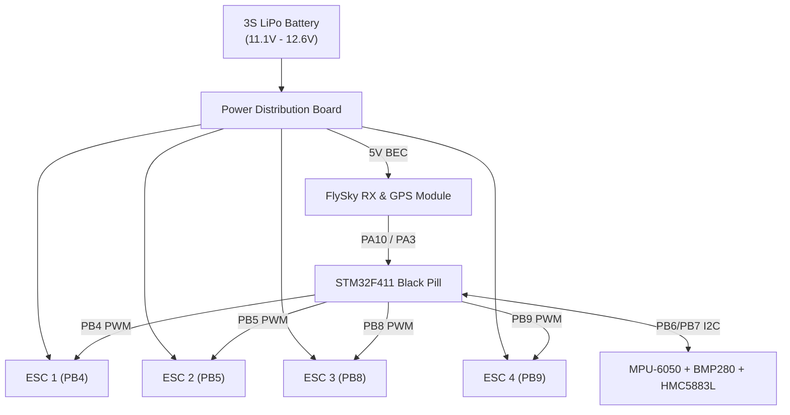

# F450 STM32F411 Black Pill INAV Complete Wiring Guide

This guide details the physical electrical wiring of all components on the F450 autonomous quadcopter.

---

## 1. I2C Sensor Bus (PB6 & PB7)

All three I2C sensors connect **in parallel** to `PB6` (SCL) and `PB7` (SDA):

```
Black Pill PB6 (SCL) <=====> MPU-6050 SCL + BMP280 SCL + HMC5883L SCL
Black Pill PB7 (SDA) <=====> MPU-6050 SDA + BMP280 SDA + HMC5883L SDA
Black Pill 3.3V      <=====> VCC of all three sensors
Black Pill GND       <=====> GND of all three sensors (COMMON GROUND)
```

| Sensor | Module | Bus Address | Function |
| :--- | :--- | :--- | :--- |
| **Primary IMU** | GY-521 (MPU-6050) | `0x68` (Clone `0x98`) | 3-axis gyro + 3-axis accelerometer |
| **Barometer** | HW-611 (BMP280) | `0x76` | Altitude hold & barometric pressure |
| **Compass** | GY-271 (HMC5883L) | `0x1E` | Heading calculation (`align_mag = CW180`) |

---

## 2. Quad-X Motor ESC Outputs

The 4 ESC signal wires connect to the dedicated hardware timer PWM pins:

| Motor Index | CLI Index | Frame Position | Spin Direction | Black Pill Pin | Hardware Timer |
| :--- | :--- | :--- | :--- | :--- | :--- |
| **Motor 1** | `mmix 0` | Rear-Left | Clockwise (CW) | **PB4** | TIM3_CH1 |
| **Motor 2** | `mmix 1` | Front-Left | Counter-Clockwise (CCW) | **PB5** | TIM3_CH2 |
| **Motor 3** | `mmix 2` | Front-Right | Clockwise (CW) | **PB8** | TIM4_CH3 |
| **Motor 4** | `mmix 3` | Rear-Right | Counter-Clockwise (CCW) | **PB9** | TIM4_CH4 |

---

## 3. GPS Module (NEO-6M)

Connects to hardware UART1:

| GPS Pin | STM32 Pin | Function |
| :--- | :--- | :--- |
| **GPS TX** | **PA10 (RX1)** | Receives satellite NMEA data into STM32 @ 57600 baud |
| **GPS RX** | **PA9 (TX1)** | Sends UBX configuration commands from STM32 |
| **GPS VCC** | **5V (from ESC BEC)** | GPS antenna power |
| **GPS GND** | **GND** | Common ground |

---

## 4. RC Receiver (FlySky i-BUS)

Connects to hardware UART2:

| Receiver Wire | STM32 Pin | Function |
| :--- | :--- | :--- |
| **i-BUS Signal** | **PA3 (RX2)** | Single-wire digital serial channel stream (124Hz) |
| **VCC** | **5V (from ESC BEC)** | Receiver power (4.5V – 6.5V) |
| **GND** | **GND** | Common ground |

---

## 5. Summary Diagram


